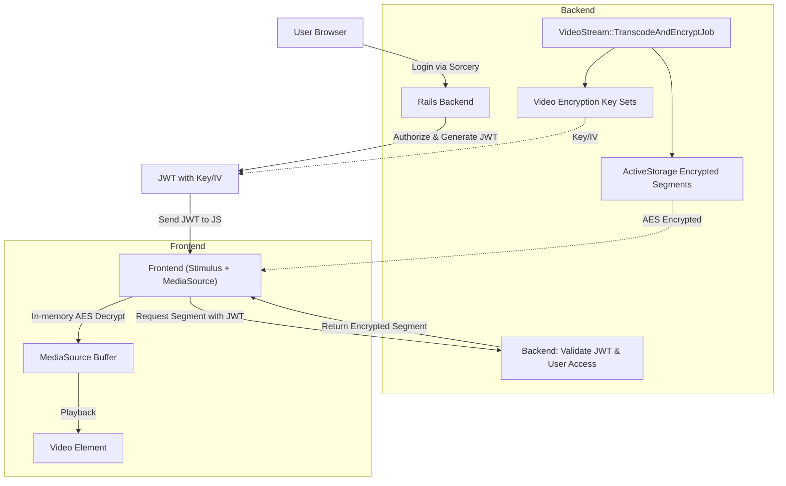

# Secure HLS Video Streaming – Complete Architecture & Security Overview

## 1. Scope and Threat Model

### Assumptions

- User is **authenticated** via Sorcery (not Devise), with roles/levels stored in `users.wing_chun_roles`.
- User has **browser access only** (no admin rights, no server console, no CLI access).
- Backend is Rails 8.1 (Propshaft, Turbo, Stimulus), PostgreSQL/SQLite, ActiveStorage.
- Budget server: 20GB storage, 4GB RAM.
- Video content is protected through application-level encryption and authorization mechanisms.
- JS in browser is observable (segment decryption happens in memory).

### Out-of-scope attacks

- Screen recording
- Reverse engineering JS
- Browser memory inspection
- Unauthorized server access

This is **controlled-access streaming** designed to protect video content through encryption, authentication, and authorization. It is not intended to prevent screen recording, browser-level inspection, or attacks requiring privileged access to the client device.
---

## 2. High-Level Architecture

### Components

- **Rails Backend**
    - Auth: Sorcery
    - Authorization: CanCanCan
    - JWT key issuance for frontend requests
    - ActiveStorage encrypted storage for segments and thumbnails
- **Background Jobs**
    - Video transcoding to multiple resolutions
    - HLS segmentation + AES encryption per segment
- **Frontend (JS)**
    - MediaSource API + Stimulus
    - Fetch encrypted segments
    - Decrypt in-memory with JWT-provided key/IV
- **Storage**
    - HLS `.m3u8` playlists per resolution
    - `.m4s` encrypted segments
    - AES key/IV stored encrypted in DB

---

## 3. Video Upload → Transcode → Encrypt Flow

1. User uploads video
2. Background job enqueues
3. Video is transcoded to multiple resolutions (480p, 1080p, 4K)
4. HLS segmentation into `.m4s`
5. AES encryption **per segment per resolution** (unique key + IV for each segment)
6. **Plain video is never persisted**

```text
[Upload]
   ↓
[Transcode Job]
   ↓
[Multiple Resolutions]
   ↓
[HLS Segmentation]
   ↓
[AES Encryption per segment]
   ↓
[Encrypted Storage]
```

## 4. Key Management

- Keys & IVs are stored **encrypted** in the database.
- Indexed via BlindIndex.
- **Each segment has its own key set** (AES key + IV).
- Key rotation occurs automatically **per segment**.
- Short-lived JWT issued for each client request, containing the `key_set_id` for the requested segment.
- Key material is **never logged**.
- This ensures that even if a JWT is intercepted, it expires quickly and is valid only for the specific segment.
---

## 5. Playback Authorization Flow

### Step 1: Request Start Token

- Browser requests a JWT from the backend.
- Rails authenticates the user and authorizes access.
- No per-segment or per-request tokens are used.

### Step 2: Fetch Encrypted Segment

- Browser requests a segment via HLS pipeline (MediaSource flow).
- Request contains:
  - video_id
  - segment_name

Example:
```text
GET /hls/:video_id/segment?segment=h1920_seg000.m4s
```

- Backend validates:
  - user access to video
  - segment existence in video_key_links

### Step 3: Key Resolution (Stateless Lookup)

- Backend resolves encryption key using relation:

```text
segment_name → video_key_links → video_encryption_key_set
```

* Returns:
  * AES key (Base64)
  * IV (Base64)

No JWT, no token chaining, no expiration per segment.

### Step 4: In-Memory Decryption

* JavaScript decrypts segment in memory using WebCrypto (AES-GCM).
* Decrypted buffer is appended to MediaSource.
* Playback is continuous via HLS segment stream.

---

## 6. Client-Side Decryption (JS)

- Decryption happens **entirely in memory**.
- No plaintext video is saved to disk.
- Supports multiple resolutions for adaptive playback.
- Ensures secure playback without exposing segments on storage.

```text
Encrypted Segment → JS in-memory decrypt → MediaSource buffer → Video playback
```

## 7. Security Properties

### ✅ Enforced

- User authorization per video.
- Short-lived JWT-based access control.
- Hotlinking prevention.
- Encrypted storage of video segments.
- Access rights enforced through CanCanCan authorization rules.
- Encryption keys are never exposed in logs or persistent client storage.

### ⚠️ Limitations

- Screen recording of video playback.
- Inspection of decrypted media data in browser memory.
- Extraction of keys or decrypted content through advanced browser debugging techniques.
- Reverse engineering of client-side JavaScript code.
- Compromise of the client device or browser environment.
---

## 8. Key Capture & Segment Reuse

- Captured JWT key/IV can decrypt **only the specific segment it was issued for**.
- Each segment has a unique key set; re-fetching segments requires a valid JWT for that segment.
- Per-request re-encryption of all segments is impractical on a budget server.

```text
Encrypted Segment → JS in-memory decrypt → MediaSource buffer → Video playback
```

## 9. Performance & Budget Considerations

- Budget server: 20GB storage, 4GB RAM.
- Multiple resolutions supported: 480p, 1080p, 4K.
- HLS segmentation reduces memory and disk load.
- **Multiple key sets per video** slightly increase DB storage, but CPU/storage overhead is low due to async encryption per segment.
- Background jobs handle transcoding + encryption asynchronously.
---

## 10. Key Specs / Environment

- **Ruby:** 4.0.0
- **Rails:** 8.1.1 (GitHub branch `8-1-stable`)
- **Storage:** ActiveStorage
- **Auth:** Sorcery + CanCanCan
- **Encryption:** Lockbox + AES
- **Background Jobs:** MissionControl Jobs / RailsEventStore
- **Frontend:** Stimulus + MediaSource API + Turbo

### Database schema highlights

- `video_encryption_key_sets`: stores key & IV encrypted.
- `video_metadata`: video info (duration, orientation).
- `video_key_links`: maps key sets to videos.
- `users`: store club_id, roles, auth info.

### Gemfile highlights

Rails, Turbo, Stimulus, Sorcery, CanCanCan, Lockbox, BlindIndex, ActiveStorage validations, image processing, JWT.

---

## 11. Summary

- Secure HLS delivery using encrypted segments + short-lived JWT keys.
- Background jobs handle transcoding + encryption.
- Frontend decrypts in-memory per segment.
- Budget-friendly design: unique key per segment, no per-request re-encryption.
- Threat model protects against unauthorized access, but not against screen capture.
- Authorization enforced via CanCanCan, scoped per video and user.
- Clear separation between backend storage, job processing, and frontend playback.

## 12. Architecture Flow Diagram



### Legend

- **JWT**: Short-lived token containing AES key & IV for authorized user/video.
- **AES Encryption**: Segments stored encrypted; decrypted only in memory.
- **MediaSource**: Supports adaptive streaming across multiple resolutions.
- **Backend Jobs**: Handle transcoding and encryption asynchronously.
- **User Access Control**: Enforced via CanCanCan, scoped per user/video.  

# Wing Chun Platform – Subscription & Payment Flow

## 1. Roles & Access

| Role        | Access during pending/payment issues       |
|------------|------------------------------------------|
| Sifu       | Read-only panel for payment management, sees subscription details, expiration date, reminders |
| Student    | Info panel: subscription not active, directs to Sifu for resolution |
| Admin      | Full access to all subscriptions, can override status |

---

## 2. Subscription Statuses

```ruby
enum status: {
  pending: "pending",                                   # Subscription created, awaiting payment declaration
  payment_verification: "payment_verification",         # Payment declared, awaiting admin verification
  active: "active",                                     # Full access granted
  rejected: "rejected",                                 # Payment rejected or verification failed
  past_due: "past_due",                                 # Payment overdue; grace period active
  expired: "expired",                                   # Grace period ended; access blocked
  deleted: "deleted",                                   # Subscription and resources removed
  interrupted: "interrupted",                           # Cancellation process started; waiting for payment verification or final cancellation
  payment_verification_cancelled: "payment_verification_cancelled", # Cancellation payment under verification
  cancelled: "cancelled",                               # Subscription cancelled without completed payment settlement
  cancelled_paid: "cancelled_paid",                     # Subscription cancelled with payment settlement completed
  finished: "finished"                                  # Subscription cycle completed successfully
}, _default: "pending"
```

## 3. Notes

### Status Definitions

- **pending** – Subscription created, payment not yet declared. User has minimal access (info panel only).

- **payment_verification** – Payment has been declared (e.g., bank transfer initiated, card authorized), awaiting admin confirmation.

  - **Sifu:** read-only panel with payment details, expiration date, and reminders.

  - **Students:** info panel directing them to Sifu; no access to video content or premium resources.

- **active** – Payment verified and subscription fully active.

  - Full access to video streaming, downloads (if enabled), protected video content, and all platform features.

- **rejected** – Payment verification failed or payment rejected.

  - Subscription access blocked until a new payment verification attempt.

- **past_due** – Subscription payment overdue; grace period active.

  - **Sifu:** reminder messages, expiration information, and limited management actions.

  - **Students:** read-only information panel; no access to protected video content.

- **expired** – Grace period ended; subscription inactive and blocked.

  - Subscription may still be resumed via `payment_verification`.

- **deleted** – Subscription permanently removed.

  - Resources deleted and account fully blocked.

- **interrupted** – Cancellation workflow initiated.

  - Subscription access restricted while awaiting cancellation resolution.

  - Can transition into payment verification for cancellation settlement or direct cancellation.

- **payment_verification_cancelled** – Cancellation-related payment is under verification.

  - Awaiting admin confirmation of the final settlement/payment connected with cancellation.

- **cancelled** – Subscription cancelled before payment settlement was completed.

  - No active access; cancellation finalized without confirmed payment.

- **cancelled_paid** – Subscription cancelled and all required payments settled successfully.

  - Final closed state for paid cancellation scenarios.

- **finished** – Subscription lifecycle completed successfully.

  - Used internally to finalize a completed subscription cycle before renewal or archival.

### Access Control Logic

- **Sifu role** always sees detailed subscription info, including expiration dates and pending payments.
- **Students and other roles** only see an informative panel explaining the subscription status and, if relevant, directing them to contact their Sifu.
- Explicit info panels provide clarity and prevent confusion: everyone knows why content is unavailable.

### Grace Periods

- Standard plan: 2 days in `past_due` + 2 days in `expired` → automatic deletion (`deleted`).
- Premium plan: configurable longer grace period (e.g., 30 days) with optional read-only access to video and resources.
- Grace period enforces payment discipline without immediately revoking all access, giving Sifu time to handle payment issues.

### Notifications

- Emails sent to Sifu (and optionally students) based on subscription timeline:
  - 2 days before subscription expires
  - On the day subscription expires
  - Daily during grace period (`past_due`)

- Expiration date displayed **only to Sifu**, ensuring clarity and accountability.

### Misc Notes

- `expired` vs `deleted`: `expired` may retain read-only access (premium), `deleted` removes all resources and blocks login.
- `cancelled` is client-initiated; behaves like `past_due` / `expired` for access purposes.
- `finished` indicates a subscription completed successfully; used internally when moving to a new subscription cycle.
- All access logic enforced via CanCanCan and subscription status enum in Rails.

## 4. Frontend Access Rules

The frontend access rules define **what each role sees and can do** depending on the subscription status. Access control is implemented via Rails/CanCanCan and conditional rendering in views.

| Subscription Status            | Sifu Access                                                                   | Student / Other Roles Access                                  |
| ------------------------------ | ----------------------------------------------------------------------------- | ------------------------------------------------------------- |
| pending                        | Minimal info / read-only panel; waiting for activation                       | Info panel: subscription created, awaiting activation         |
| payment_verification           | Read-only panel with payment verification details; no resource modifications | Info panel: payment under verification; no access             |
| active                         | Full panel: video streaming, uploads (if allowed), all platform features     | Full access: video streaming, courses, and protected video content |
| past_due                       | Reminder panel; restricted actions; option to resume via payment verification| Info panel: subscription overdue; no access to video content |
| rejected                       | Payment verification failed or payment rejected; access blocked              | Info panel: payment rejected; no access; subscription remains blocked and proceeds toward deletion |
| expired                        | Limited access; subscription expired; option to resume via payment verification | Info panel: subscription expired; no access                |
| deleted                        | No access; subscription permanently removed                                   | No access                                                     |
| interrupted                    | Cancellation in progress; limited actions; awaiting resolution                | Info panel: cancellation in progress                          |
| payment_verification_cancelled | Read-only cancellation settlement verification panel                          | Info panel: cancellation payment under verification           |
| cancelled                      | Subscription cancelled; no active access                                      | Info panel: subscription cancelled                            |
| cancelled_paid                 | Finalized paid cancellation; historical/read-only information only            | No access                                                     |
| finished                       | Subscription cycle completed; prepares for next subscription lifecycle        | No UI impact; next subscription starts from `pending`         |

- **Explicit messaging:** Students always see the reason access is restricted; prevents confusion.
- **Sifu panel:** Always shows expiration date, payment status, and any pending actions.
- **Read-only rules:** During `past_due` or `payment_verification`, Sifu can view but not modify premium resources; Students cannot access protected video content.
- **Premium plan exception:** Grace period may allow read-only video access for Students while still restricting uploads and other interactions.
- **UI cues:** Info panels indicate dates of expiration, grace period end, and link to Sifu for resolution.

---

## 5. Notes on Grace & Premium Plans

- **Grace Periods**
  - Standard plan: `past_due` 2 days + `expired` 2 days → automatic deletion (`deleted`).
  - Premium plan: configurable longer grace period (e.g., 30 days), with optional read-only access to video and other resources.
  - Purpose: enforce payment discipline while allowing short delays without immediate loss of content.

- **Premium Plan Features**
  - Extended grace period with read-only video access for students.
  - Retention of uploaded resources during overdue period.
  - Optional early notifications and detailed reminders to Sifu.
  - Higher pricing reflects additional benefits and risk management for unpaid periods.

- **Notifications & Reminders**
  - Emails sent to Sifu and optionally students:
    - 2 days before subscription ends
    - On the day subscription ends
    - Daily during grace period (`past_due`)
  - Expiration date visible **only to Sifu**; ensures clear accountability.

- **Behavior on Renewal**
  - If subscription is renewed during grace period:
    - Current subscription marked as `finished`
    - New subscription created starting at `pending` → `payment_verification` → `active`
    - Previous resources are retained if within grace period rules

---

## 6. Implementation Notes (Rails)

- **Models & Relationships**
  - `SubscriptionPlan` → has_many `subscriptions` → has_many `store_costs`
  - `Subscription` → belongs_to `club` and `subscription_plan`
  - `Subscription` uses `enum status` to track lifecycle: `pending`, `payment_verification`, `active`, `past_due`, `expired`, `deleted`, `cancelled`, `finished`
  - `Club` has_many `subscriptions` (ordered by `created_at DESC`)

- **Scopes**
  - `Subscription.recent` → order by created_at desc
  - `StoreCost.recent` → order by created_at desc

- **Status Handling & Workflow**
  - New subscription starts at `pending`
  - After payment declaration → `payment_verification`
  - Admin confirms → `active`; otherwise `rejected`
  - If payment overdue → `past_due` → `expired` → auto-delete (`deleted`)
  - `finished` applied to previous subscription when new one created
  - `cancelled` applied if subscription is terminated by client (user-initiated)

- **Access Control**
  - Enforced via **CanCanCan**, scoped by role and subscription status
  - Conditional frontend panels based on status and role (Sifu vs Student / others)
  - Explicit messaging prevents confusion for unpaid or expired accounts

- **Notifications / Jobs**
  - Background jobs for email reminders (2 days before, day of expiration, during grace period)
  - Optional webhook or internal notifications to Sifu for overdue payments
  - Jobs ensure correct enforcement of grace period timelines and resource deletion

- **Future Enhancements**
  - Premium plan with longer grace period and partial read-only access
  - Billing calculations for partial periods if user pays late
  - Optional subscription analytics for Sifu / Club dashboards

## 7. Upcoming Implementation Tasks

### Video & Storage Validation
- Implement video upload validation per subscription plan (file size limit and total storage/usage limit).
- Block uploads when plan limits are exceeded or subscription is not `active`.
- Recalculate and persist storage usage after each successful upload.
- Recalculate and adjust storage usage (`StoreCost`) after video deletion (increase/decrease accounting model).

---

### Subscription & Club Visibility
- Implement subscription plan visibility per club (currently one club, but structure prepared for multiple).
- Ensure only one active subscription per club at a time.
- Display current plan, expiration date, grace period end, and usage summary in club panel.

---

### Billing Panels
- Implement billing panel per club (Sifu role):
  - View subscription status, expiration, payment state.
  - Request renewal or declare payment.
- Implement separate Super Admin panel:
  - View all clubs and subscriptions.
  - Approve/reject payments.
  - Manually override subscription status (with audit trail).

---

### Access Control & Status Enforcement
- Enforce login and feature access based strictly on subscription status.
- Restrict uploads, video streaming, and resource creation when subscription is not `active`.
- Implement explicit subscription status checks in a centralized access policy/service.
- Ensure subscription creation and status changes are performed explicitly via panel actions (no implicit callbacks).

---

### Expiration & User Messaging
- Display clear “Subscription expired” information panel:
  - For Sifu → detailed expiration info and reminders.
  - For Students → informational message directing to Sifu.
- Prevent confusion by always explaining why access is restricted.

---

### Notifications
- Implement background jobs for email reminders to Sifu:
  - 2 days before expiration.
  - On expiration day.
  - Daily during `past_due` grace period.
- Ensure emails stop once subscription becomes `active` again.

---

### Automatic Cleanup
- Implement background worker for automatic resource cleanup:
  - Trigger after grace period ends.
  - Delete videos and associated encrypted segments.
  - Record `StoreCost` decrease entries.
  - Change subscription status to `deleted`.
- Avoid manual cleanup from admin panel.

---

### Testing
- Add unit tests for:
  - Subscription status transitions.
  - Access policy logic.
  - Storage usage calculation.
  - Cleanup worker.
- Add system tests for:
  - Upload restrictions.
  - Expired subscription behavior.
  - Renewal during grace period.
  - Automatic deletion flow.

## 8. Subscription Lifecycle & Data Cleanup

This section clarifies the timing, consequences, and rules for overdue subscriptions, including permanent removal of video content.

### Status Timeline

| Status       | Duration | Description & Consequences |
|--------------|---------|----------------------------|
| **past_due** | 2 days  | Short grace period. Sifu sees reminders and expiration date. Students see an info panel: "Your Sifu has not paid the subscription". Access to premium content and video is blocked. |
| **expired**  | 5 days  | Extended grace period. Sifu can still renew or pay the overdue subscription. Students remain blocked. No new uploads or content changes allowed. |
| **deleted**  | immediate after `expired` | All videos and resources are deleted from Active Storage. Students linked to the club become inactive. Sifu retains login access but cannot perform actions unless a new subscription is purchased. Database references remain for historical purposes, but **no storage space is occupied**.  

### Key Rules

- **No skipping payments:** A new subscription cannot be purchased if the account is in `past_due`, `expired`, `rejected`, or `deleted`. This prevents circumventing unpaid periods.
- **Material loss:** If the Sifu delays payment beyond the grace period, all videos and content are permanently deleted. This is a real and irreversible loss.
- **Notifications:** Sifu receives emails during `past_due` and `expired` reminding about overdue payments. Students only see the info panel explaining the lack of access.
- **Reactivation:** If the Sifu later purchases a new subscription, access resumes **only to the new subscription period**. Previous content is permanently lost.
- **Storage Cleanup:** When a subscription reaches `deleted`:
  - Encrypted video segments, playlists, and related resources are permanently removed from Active Storage.
  - References remain in the database for history but occupy no storage.
  - Any new subscription starts fresh; old content **cannot be restored**.
  - This ensures storage costs are minimized and the resource lifecycle is clean.

## 9. Notifications & User Deactivation

This section defines email notifications and user access changes for overdue subscriptions.

### Email Notifications Timeline

| Status       | Timing & Frequency | Content / Purpose |
|--------------|-----------------|-----------------|
| **3 days before subscription ends** | Once | Reminder to Sifu that subscription is about to expire. |
| **past_due** | Daily until `expired` or payment received | Reminder about overdue payment. Students see info panel: "Your Sifu has not paid the subscription". Access to premium content is blocked. |
| **expired** | Daily until `deleted` or payment received | Continues reminders; Sifu sees overdue info. Students remain blocked. |
| **deleted** | Once, immediately after `expired` grace period | Final notice: subscription deleted, all video content removed, students deactivated. Explains reason for blocking and permanent content loss. |

### Key Rules

- **Sifu visibility:** All reminders and subscription status changes are visible in a dedicated panel, showing who is in `past_due` or `expired`.
- **Student access:** Students cannot access premium content during `past_due` or `expired`; info panels explain the situation.
- **Deactivation:** Once subscription reaches `deleted`, all students linked to the club are deactivated. Sifu retains login access but cannot perform actions unless a new subscription is purchased.
- **No skipping payments:** New subscriptions cannot be purchased if current status is `past_due`, `expired`, `rejected`, or `deleted`.
- **Consistency:** Emails and panel info provide clear accountability and prevent confusion about content access or account status.

### 10. Subscription Plans and Video Limits

The system supports three main subscription plans, differing in upload limits, worker capacity, user limits, and encryption features:

| Plan      | Max Upload per Video | Period Limit | Workers | User Limit | Encryption Features |
|-----------|--------------------|--------------|---------|------------|-------------------|
| **Standard** | 3 GB              | 12 GB        | 1       | 50         | Standard AES per segment |
| **Plus**     | 5 GB              | 30 GB        | 3       | 200        | Standard AES per segment |
| **Deluxe**   | 7 GB              | 50 GB        | 5       | Unlimited  | Standard AES per segment |

**Plan Descriptions:**

- **Standard** – Basic plan for small clubs or limited user groups (up to 50 users).
- **Plus** – Mid-tier plan, suitable for clubs with more members or larger video content (up to 200 users).
- **Deluxe** – Premium plan, offering the highest content security with **full per-session key rotation**, periodic segment re-encryption, higher period limit, and **unlimited users**.

> Each video is transcoded to HLS (fMP4) in multiple quality levels, and segments are AES encrypted. The frontend dynamically fetches decryption keys during playback to ensure full content protection. Deluxe plan users benefit from additional security via full key rotation for each playback session.

### 11. Pre-Finalization Steps

1. **Migration to PostgreSQL** – replace SQLite with PostgreSQL.
2. **Enable Wasabi + ActiveStorage** – set up storage backend and migrate existing data.
3. **Network cache activation** – ensure HLS segments and manifests are served via network cache/CDN.
4. **Upgrade server resources** – expand from current 20 GB disk to ~2 TB, increase RAM to ~64 GB, and upgrade CPU for smooth processing.
