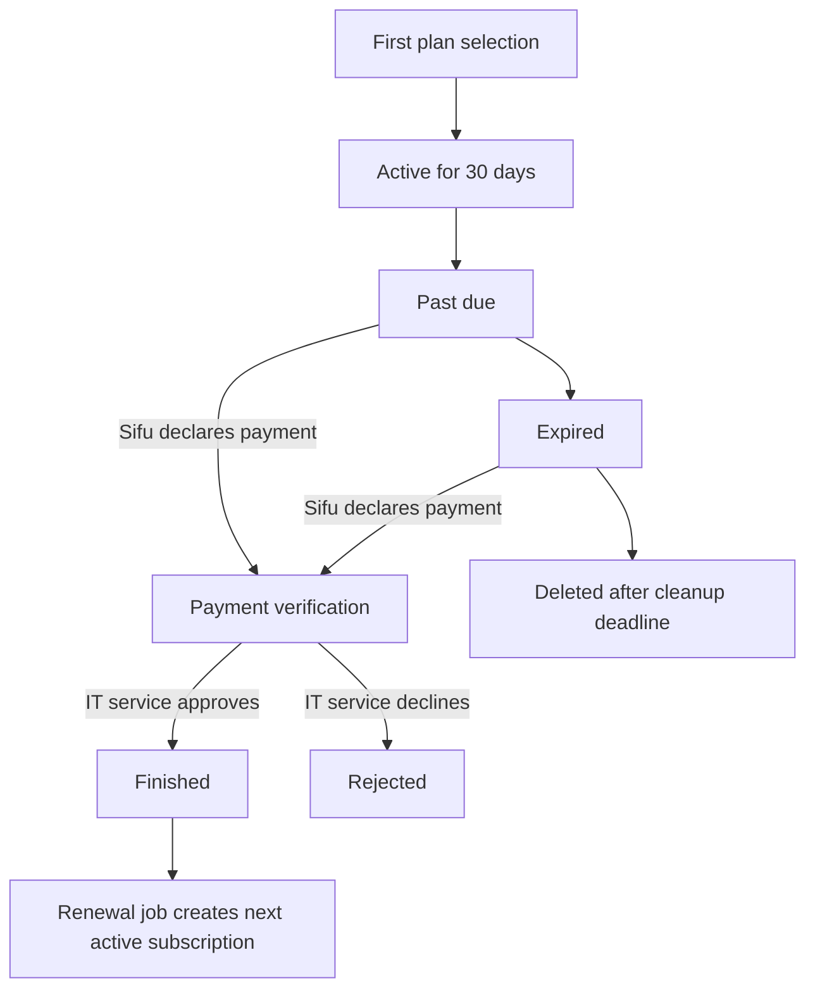

# Encrypted HLS Video Playback

This document follows the current upload and playback implementation in `app/services/video_stream`, `HlsController`, and the Stimulus HLS player. The player decrypts one encrypted fMP4 media segment at a time in the browser and appends it to a `MediaSource` buffer.

## Components

- **Rails** authenticates requests and authorizes video access with CanCanCan.
- **Video processing jobs** transcode an uploaded source into quality-specific fMP4 HLS playlists and segments.
- **Active Storage** holds playlists, initialization segments, and encrypted media segments.
- **Stimulus player** fetches the selected quality playlist and initialization segment, then fetches, decrypts, and appends media segments as playback advances.
- **CDN** is used as the base URL for playlist, initialization, and media-segment requests in production. Key requests go to the Rails application.

## Upload, transcode, and encryption

1. A video source is uploaded and the video processing job is enqueued.
2. FFmpeg creates portrait or landscape encodes at the configured quality levels. The HLS output uses fMP4: an initialization `.mp4` file plus `.m4s` media segments, with a target duration of about seven seconds.
3. Each media segment gets its own random 32-byte AES key and 12-byte IV. The segment is encrypted with AES-256-GCM; the authentication tag is appended to the encrypted bytes.
4. The encrypted segment is attached to the video. A `VideoKeyLink` associates its filename with its `VideoEncryptionKeySet`, which stores the key and IV encrypted in the database.
5. The level playlists and initialization segments are attached separately. After processing, the job schedules removal of the uploaded source and deletes its local temporary output directory.

The source and intermediate plaintext files exist during upload/transcoding. The stored `.m4s` media segments are encrypted, while the playlist and fMP4 initialization files are not encrypted media segments.

```text
Uploaded source
    ↓
FFmpeg quality encodes and fMP4 HLS segmentation
    ↓
Per-segment AES-256-GCM encryption + unique key/IV
    ↓
Encrypted .m4s segments + key links in storage/database
```

## Playback setup

`VideoPlayerComponent` renders the `<video>` element with the Stimulus `video-player` controller and passes the video ID, selected level-playlist URL, matching initialization-segment URL, club slug, and CDN base URL. The quality selector chooses a level playlist and reloads the player for that quality; the current player does not switch quality adaptively during playback.

On initialization, the controller creates `HLSPlayer`, which:

1. Fetches and parses the selected level playlist into a segment-to-time map using each `#EXTINF` duration.
2. Creates a `MediaSource` and `SourceBuffer` for the fMP4 video/audio codecs.
3. Fetches and appends the selected quality's initialization segment. This initialization file is not encrypted by the per-media-segment encryption step.
4. Starts navigation based on the video element's playback time and seek events.

The relevant Rails routes are:

```text
GET /clubs/:club_slug/hls/:video_id/level_playlists/:filename
GET /clubs/:club_slug/hls/:video_id/init_segment?quality=:quality
GET /clubs/:club_slug/hls/:video_id/segment/:filename
GET /clubs/:club_slug/hls/:video_id/key?segment=:segment_name
```

## Segment-by-segment playback and decryption

For the segment covering the current playback time, the player follows this sequence:

1. **Find the segment.** `HLSNavigator` uses the parsed playlist timeline to find the segment that contains `video.currentTime`.
2. **Request that segment's key.** `SegmentFetcher` calls the Rails `key` endpoint with the segment URL/name. The route requires a signed-in user; `HlsController#key` scopes the video to videos the user can access and runs `authorize! :read` before looking up the matching `VideoKeyLink`.
3. **Decode the key response.** Rails reads the linked key set and returns its key and IV as a binary response. The response swaps each adjacent byte as a reversible representation transform; the JavaScript client reverses that transform and splits the bytes into the 32-byte key and 12-byte IV. This byte swapping is not encryption or a security boundary.
4. **Fetch the encrypted `.m4s` segment.** The segment request includes browser credentials. Rails authorizes access, finds the sanitized filename, and checks the subscription's CDN transfer limit before returning the encrypted bytes.
5. **Decrypt in memory.** `DecryptionService` imports the raw AES key into WebCrypto and decrypts the ciphertext plus appended GCM authentication tag using AES-GCM and the segment's IV.
6. **Append and continue.** `MediaBufferController` appends the decrypted `ArrayBuffer` to the `SourceBuffer`. The navigator prefetches the next segment and removes old segment names from its active-fetch set once they are more than 30 seconds behind. On seeking, it clears its client-side `bufferedSegments` tracking, runs the buffer cleanup path, and requests the target segment again. The cleanup call uses the default zero cutoff, so it does not remove positive-duration `SourceBuffer` ranges.

There is no playback-start JWT, per-request JWT, or JWT containing a `key_set_id`. Key retrieval is a separate authenticated Rails request for each segment; authorization is checked by the key and segment actions themselves.

```text
Playlist timeline
    ↓
Current segment → authenticated key lookup → encrypted segment fetch
    ↓                                           ↓
    └────────────── AES-GCM decrypt in memory ──┘
                           ↓
                  MediaSource SourceBuffer
                           ↓
                    HTML video playback
```

## Authorization, caching, and limits

- HLS routes are constrained to logged-in users. Playlist, key, and segment actions resolve the video through the user's accessible video scope and call CanCanCan authorization.
- The key response is explicitly marked `no-store` and `no-cache`.
- Playlist and media-segment responses use long-lived public cache headers (three months; immutable for playlists and media segments). Rails authorization applies when the request reaches the origin; the deployed CDN's cache configuration is therefore part of the effective delivery/access design.
- The subscription tracks bytes served through the segment action. When the transfer limit is exceeded, the endpoint returns HTTP 403 with `cdn_limit_exceeded`; the player opens the corresponding Turbo modal.
- The key and IV are unique per media segment and stored encrypted in the database. The browser necessarily receives them to decrypt playback, and the plaintext segment is held in browser memory before it is appended to MediaSource.

## Security limits

This design restricts access through authenticated application routes and encrypts media segments in storage. It does not prevent screen recording, browser memory inspection, developer-tools capture, or reverse engineering. A captured key and IV can decrypt the associated encrypted segment; there is no short expiry or one-request binding on the key material. The reversible byte-swap in the key response should not be treated as cryptographic protection.

## Implementation map

- Upload job and encryption: `app/jobs/video_stream/transcode_and_encrypt_job.rb`, `app/jobs/video_stream/club/transcode_and_encrypt_job.rb`, and `app/services/video_stream/encryption/transcoder.rb`.
- AES-GCM encryption: `app/services/video_stream/crypto/encryptor.rb`.
- Key storage and per-segment mapping: `app/models/video_encryption_key_set.rb` and `app/models/video_key_link.rb`.
- Authenticated playlist, key, init, and segment endpoints: `app/controllers/hls_controller.rb`.
- Player setup and UI parameters: `app/javascript/video_controllers/video_player_controller.js` and `app/components/video_player_component.html.erb`.
- Playlist fetching, segment mapping, and key response decoding: `app/javascript/video_controllers/hls/segment_fetcher.js` and `hls_segment_map.js`.
- Segment selection, decryption, and buffering: `hls_navigator.js`, `hls_segment_manager.js`, `decryption_service.js`, and `media_buffer_controller.js` in the same directory.

# Subscriptions, Billing, and Access

This document describes the subscription flow implemented in the Rails application. The subscription belongs to a club; its most recently created record is the club's `current_subscription`.

## Roles

| Role | Subscription actions |
| --- | --- |
| Sifu | Select the club's first plan, choose a current or higher plan for the next period, view dates and charges, declare renewal or cancellation payment, and interrupt an active subscription. A Sifu cannot approve payments. |
| IT service (`it_service`) | Review and approve or decline payment declarations, including cancellation settlements; manage subscriptions. |
| Other club members | Do not manage subscription or payment state. When the subscription has expired or is missing, signed-in users are redirected to the subscription notice. |

## First subscription and plan changes

1. A Sifu opens the plan list and selects a plan for a club with no subscription history.
2. The application creates a 30-day subscription in `active` status. There is no card checkout or initial payment-verification step in this flow.
3. The Sifu can set a `NextSubscriptionPlan` for the next renewal. The current plan and higher tiers are available; a plan change does not alter the current subscription immediately.

The `pending` enum value remains available in the model, but the current first-subscription action creates subscriptions as `active`.

## Renewal and payment verification

Renewal is handled as a declared payment workflow rather than an automatic card charge:

1. The Sifu selects the plan for the next period (or leaves the current plan selected).
2. When the current period is overdue, the Sifu records a payment declaration. The subscription moves from `past_due` or `expired` to `payment_verification`.
3. An IT service user approves the declaration by moving the subscription to `finished`, or declines it by moving it to `rejected`.
4. The subscription processor publishes the finished stage. A renewal job creates a new 30-day `active` subscription using the selected next plan, or the previous plan if no next plan was selected. Existing video storage is recorded against the new subscription and a renewal email is sent.



## Subscription statuses

The transition rules are defined in `Subscription::Status::Strategy`.

| Status | Meaning and next steps |
| --- | --- |
| `pending` | Model default; may transition to `active` or `rejected`. Not used by the current first-plan selection flow. |
| `active` | Current paid period. May be interrupted by the Sifu or progress to `past_due` after its end date. |
| `past_due` | Period has ended. The Sifu can declare a renewal payment; otherwise the processor advances it to `expired`. |
| `expired` | Two-day past-due window has elapsed. The Sifu can still declare payment; otherwise the record proceeds to deletion. |
| `payment_verification` | Renewal payment declared and awaiting IT service review. Approval sets `finished`; rejection sets `rejected`. |
| `rejected` | Payment was declined. The processor moves the subscription to deletion and triggers cleanup. |
| `finished` | Renewal accepted. The processor publishes a finished event, which triggers creation of the next subscription. |
| `interrupted` | Subscription cancellation workflow started by the Sifu. It can move to `payment_verification_cancelled` or `cancelled`. |
| `payment_verification_cancelled` | Cancellation settlement is awaiting IT service review. It can move to `cancelled_paid` or `cancelled`. |
| `cancelled_paid` | Cancellation settlement accepted; terminal status. |
| `cancelled` | Cancellation finalized without an accepted settlement; terminal status. |
| `deleted` | Terminal status. The club is deactivated and video and album cleanup jobs are enqueued. |

The enum contains all statuses, but the listed transition rules determine which status changes are accepted by the application.

## Expiration, access, and cleanup

- A subscription period lasts 30 days. The processor sends a pre-overdue email about two days before `end_time`, marks subscriptions `past_due` after the period ends, and sends overdue/expired stage emails as it advances them.
- `past_due` lasts two days. `expired` then lasts five additional days. At the end of that seven-day post-expiration window, the processor marks the subscription `deleted` (except for the main portal club).
- Application access is checked against the subscription end date, not just the stored status. As soon as `end_time` has passed, signed-in users are redirected to `/dashboard/warning`; the Sifu sees the deadline and plan action, while other members are asked to contact the Sifu. The grace window retains data for resolution, but does not grant normal application access.
- Deletion deactivates the club and enqueues removal of its videos and video albums. A rejected payment also proceeds to deletion when the processor runs.
- Renewal is available during the `past_due` and `expired` stages. After deletion, the current code does not restore the removed video content.

`Subscription::ProcessingJob` implements these time-based stages. This repository does not define an in-repo recurring schedule for that job in `config/recurring.yml`; a deployment scheduler must invoke it for the transitions and stage emails to run.

## Fees and plan limits

Each subscription has a base plan fee plus a usage-based storage charge. Storage charges are calculated from recorded video usage and the portion of the subscription period for which that usage was retained. Upload/processing usage is tracked separately from the final retained video usage. The Sifu's subscription panel shows the plan fee, storage breakdown, total due, transfer usage, and plan limits.

The following are model defaults. `subscription_plans.price_gross_base`, when set, is used for the displayed base fee.

| Plan | Default base fee / 30 days (PLN) | Max video upload | Video usage limit / period | CDN transfer limit | Processing jobs | Club users |
| --- | ---: | ---: | ---: | ---: | ---: | ---: |
| Standard | 30 | 3 GB | 12 GB | 200 GB | 1 | 50 |
| Plus | 50 | 5 GB | 30 GB | 500 GB | 3 | 200 |
| Deluxe | 80 | 7 GB | 50 GB | 800 GB | 5 | Unlimited |

The default storage rate is `0.00007` PLN per MB. Video segment requests increment the subscription's CDN transfer usage; when the plan limit is exceeded, the HLS endpoint returns `cdn_limit_exceeded` and the player displays the corresponding notice.

## Implementation map

- Plan selection and initial creation: `SubscriptionPlansController`, `SubscriptionSelectionsController`, `SubscriptionPlan::Creator`, and `SubscriptionPlan#build_factory_subscription_for`.
- Future plan selection and allowed upgrades: `NextSubscriptionPlansController` and `NextSubscriptionPlan`.
- Statuses, deadlines, and transitions: `Subscription` and `Subscription::Status::Strategy`.
- Period processing and stage events: `Subscription::ProcessingJob` and `config/initializers/rails_event_store.rb`.
- Renewal and usage carry-forward: `Subscription::Renew`.
- Payment review: `WingChunKungFu::Administration::SubscriptionsController` and `SubscriptionPaymentsController`.
- Access redirect: `ApplicationController#check_subscription` and `DashboardController#warning`.
- Storage and transfer charges: `StoreCost::Calculate::Presentation` and `Subscription::ConsumeCdnTransfer`.
